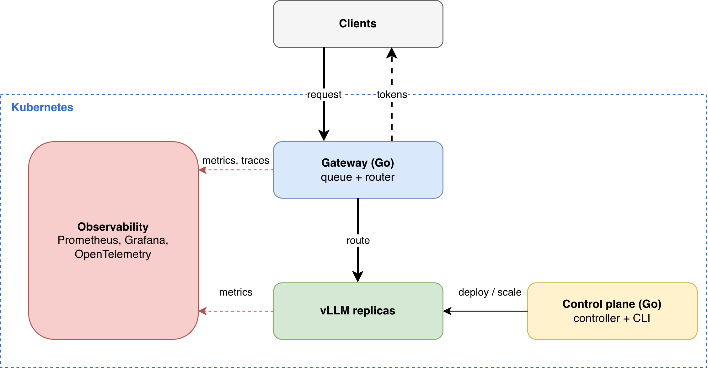

<h1 align="center">os-llm</h1>

    A Kubernetes platform for serving and observing LLMs, with a Go control plane and an OpenAI-compatible API.

  
  
  
  
  
  

> **Status:** in progress.

## Core Components

### Gateway (Go)

- OpenAI-compatible API with streaming
- Admission queue: absorbs bursts, protects replicas from overload
- Router: sends each request to the least-busy replica

### Inference

- vLLM replicas serving models

### Control Plane (Go)

- Controller: deploys, scales and rolls back models
- CLI: operator interface (deploy, list, status, rollback)

### Observability

- Prometheus: metrics
- Grafana: dashboards
- OpenTelemetry: traces

## Request Flow

1. Client sends an OpenAI-format request to the gateway
2. Gateway queues it if every replica is at capacity
3. Router picks the least-busy vLLM replica
4. Tokens stream back to the client

## Roadmap

- [ ] Gateway: OpenAI-compatible API, streaming, routing
- [ ] Admission queue and least-busy routing
- [ ] Controller and ModelDeployment resource
- [ ] CLI: deploy, list, status, rollback
- [ ] Autoscaling on queue depth
- [ ] Metrics, dashboards and traces
- [ ] Benchmarks: time to first token, p99 latency, tokens/sec

## Why

Built to understand how a production inference platform is operated: routing, admission control, scaling and observability.

### Initial Concept

