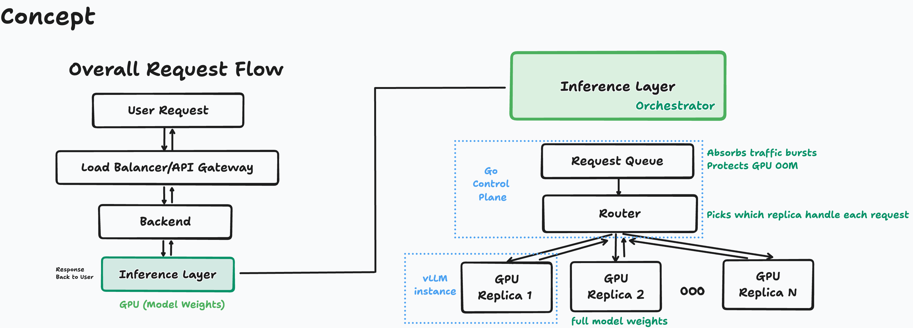

<h1 align="center">llmctl</h1>

    An inference platform for serving LLMs efficiently and observably.

  
  
  
  
  
  
  

## Core Components

### Control Plane
- Go service: inference server lifecycle management (deploying, scaling, swapping)
- Go CLI: operator interface for the platform

### Inference
- vLLM instances: serving models via API

### Infrastructure
- K8s: workload orchestration

### Observability
- Prometheus: metrics
- Grafana: dashboards
- OpenTelemetry: traces

## Prerequisites
## Installation
## Usage
## Benchmarks
## Roadmap
## Learnings

